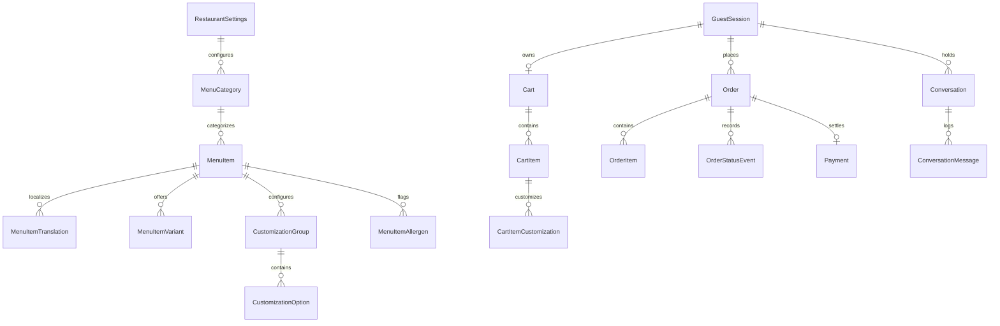
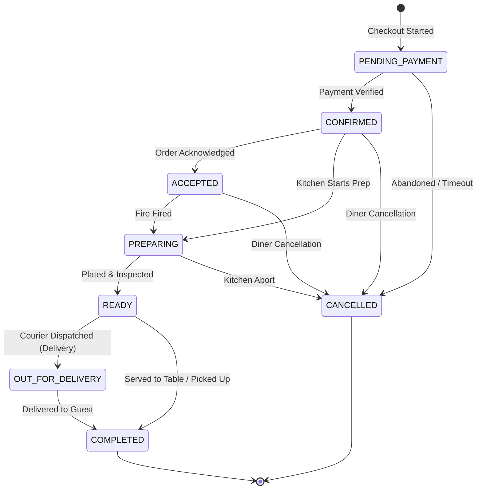

# ECHO — System Architecture & Technical Specification

## 1. Executive Summary

ECHO is a production-grade restaurant platform for a luxury gastronomic destination celebrating **Progressive Global Hearth & Botanicals** (live fruitwood embers, heirloom grains, wild foraged aromatics).

The platform bridges three synchronized interaction modalities:
1. **Visual Touch & Direct Navigation** (editorial visual storefront, category navigation, dish detail modals, multi-fulfillment checkout).
2. **Text-Based Multilingual AI Concierge** (conversational ordering, pairings, allergen inquiries, live order tracking).
3. **Voice-Driven Concierge** powered by **ElevenLabs** (Voice ID `sXSV9RZ095VZyL64w3ap`) with real-time WebAudio FFT frequency visualization and Web Speech API fallback.

---

## 2. Core Architectural Principles

- **Database as Sole Authority**: The AI concierge proposes and inspects actions through deterministic tool calls. The server validates and executes all changes. The AI never invents dishes, modifiers, prices, availability, or order statuses.
- **Zero Floating-Point Financials**: All prices, taxes, tips, and fees are stored and computed in integer minor units (cents). Tax is computed using basis points ($825 = 8.25\%$).
- **Dual-Tier Resiliency**:
  - *Voice*: ElevenLabs Conversational AI / TTS (Tier 1) with automatic browser Web Speech API (Tier 2).
  - *Payments*: Stripe Checkout (Tier 1) with instant simulated zero-credential sandbox (Tier 2).
  - *AI Intelligence*: Gemini 2.0 Flash function calling (Tier 1) with deterministic semantic intent router (Tier 2).
- **Session Isolation**: Guest sessions are cookie-isolated (`echo_session`) with separate carts, orders, and conversational contexts.

---

## 3. Database Schema (Prisma / SQLite)

The schema comprises 19 relational models:



### Models
1. `RestaurantSettings`: Authoritative restaurant metadata, brand voice, address, hours, base currency, tax rate.
2. `MenuCategory`: Hearth Starters, Open-Fire Mains, Coastal Botanicals, Ancient Grains & Breads, Embers & Sweets, Zero-Proof Elixirs, Hearth Cellar.
3. `MenuItem`: Dish entity with `basePriceMinor`, `spiceLevel` (0-3), `cookingTechnique`, `dietaryFlags` JSON, `isAvailable` (86 flag).
4. `MenuItemTranslation`: Localized titles, descriptions, and tasting notes in `en`, `hi`, `te`, `es`, `fr`.
5. `MenuItemVariant`: Sizing / cut variants (e.g. 8oz vs 16oz bone-in ribeye).
6. `CustomizationGroup`: Options (wood smoke level, herb infusions, dietary adjustments) with `minSelect` and `maxSelect`.
7. `CustomizationOption`: Modifier with `priceDeltaMinor` in cents.
8. `MenuItemAllergen`: Verified allergens (`GLUTEN`, `DAIRY`, `NUTS`, `SHELLFISH`, `SOY`, `EGGS`).
9. `GuestSession`: Ephemeral diner session id (`echo_session`).
10. `Cart`: Diner cart linked to guest session.
11. `CartItem`: Line item with quantity and selected variant.
12. `CartItemCustomization`: Selected modifier IDs and price deltas.
13. `Order`: Placed order with unique reference `ECHO-XXXX`, fulfillment details (DINE_IN, PICKUP, DELIVERY), and totals.
14. `OrderItem`: Immutable frozen snapshot of purchased dish, variant, and customizations.
15. `OrderStatusEvent`: Audit trail of every lifecycle event.
16. `Payment`: Stripe or Sandbox payment record with provider IDs and webhook event idempotency.
17. `Conversation`: Concierge conversation thread linked to session and locale.
18. `ConversationMessage`: Turn history with tool calls and tool result payloads.
19. `Profile`: Optional registered diner profile for order history and dietary preferences.

---

## 4. Concierge Tool Pipeline (14 Authoritative Tools)

The AI Dining Concierge has access to 14 verified backend tools:

| # | Tool Name | Scope | Description |
|---|---|---|---|
| 1 | `browse_menu` | Discovery | Search dishes by category, keyword, dietary flags, or spice level |
| 2 | `get_item_details` | Gastronomy | Retrieve verified ingredients, allergens, cuts, and cooking techniques |
| 3 | `recommend_items` | Pairing | Suggest culinary centerpieces and sommelier pairings based on palate |
| 4 | `customize_item` | Customization | Validate custom combinations and compute unit price delta |
| 5 | `add_to_cart` | Commerce | Add dish with variant and customizations to diner's cart |
| 6 | `view_cart` | Commerce | Inspect cart line items, subtotal, tax, and total |
| 7 | `update_cart_item` | Commerce | Modify line item quantity |
| 8 | `remove_from_cart` | Commerce | Remove line item |
| 9 | `get_restaurant_information` | Hospitality | Authoritative hours, location, contact, and reservations |
| 10 | `prepare_checkout` | Commerce | Validate availability, required fulfillment fields, and compute final fees |
| 11 | `create_checkout_session` | Payment | Initiate Stripe Checkout or sandbox fulfillment session |
| 12 | `get_order_status` | Tracking | Real-time fulfillment status and preparation timeline |
| 13 | `get_order_history` | Account | Past orders for the active diner session |
| 14 | `cancel_order` | Cancellation | Cancel eligible order before hearth prep begins |

---

## 5. ElevenLabs Voice & WebAudio Architecture

```
User Microphone
      │
      ▼
MediaStream ────────► RealAudioAnalyser (WebAudio FFT) ────────► VoiceVisualizer (Live Orb & Equalizer)
      │
      ▼
Speech Recognition (Official ConvAI SDK or Web Speech API)
      │
      ▼
/api/concierge/chat ──► 14-Tool Pipeline ──► Verified Response
                                                    │
                                                    ▼
ElevenLabs TTS (/api/voice/tts) ────────► Audio Playback ──────► RealAudioAnalyser
(Voice ID: sXSV9RZ095VZyL64w3ap)
```

- **Voice ID**: `sXSV9RZ095VZyL64w3ap` ("Alexa" — soft, warm, friendly Brazilian female tone).
- **Acoustic Fidelity**: `RealAudioAnalyser` wraps `AudioContext` and `AnalyserNode` with `fftSize: 64`. Frequency energy is calculated dynamically and drives the glowing hearth orb and 16-bar spectrum. When muted or idle, values are exactly 0 (no simulated CSS pulsing).
- **Multilingual Support**: Real-time language switching between English (`en`), Hindi (`hi`), Telugu (`te`), Spanish (`es`), and French (`fr`).

---

## 6. Order State Machine



---

## 7. Staff Operations Dashboard

Accessible at `/staff`:
- **Kitchen Kanban** (`/staff/orders`): 4-column live queue with auto-refresh every 10 seconds. Staff can inspect dish modifications, table numbers, and advance orders through the state machine.
- **Dish 86 Management** (`/staff/menu`): Instant availability toggles by category. 86'd items immediately disappear from public menus and are disallowed in cart operations and concierge recommendations.
- **Passkey Protection**: Secured via HTTP-only cookie `echo_staff_token` against `STAFF_PASSWORD`.
